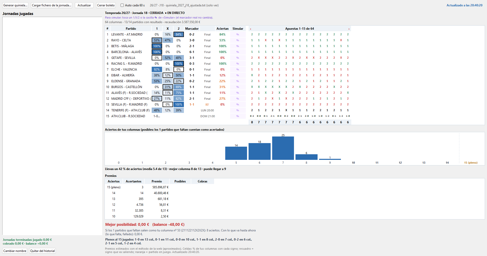
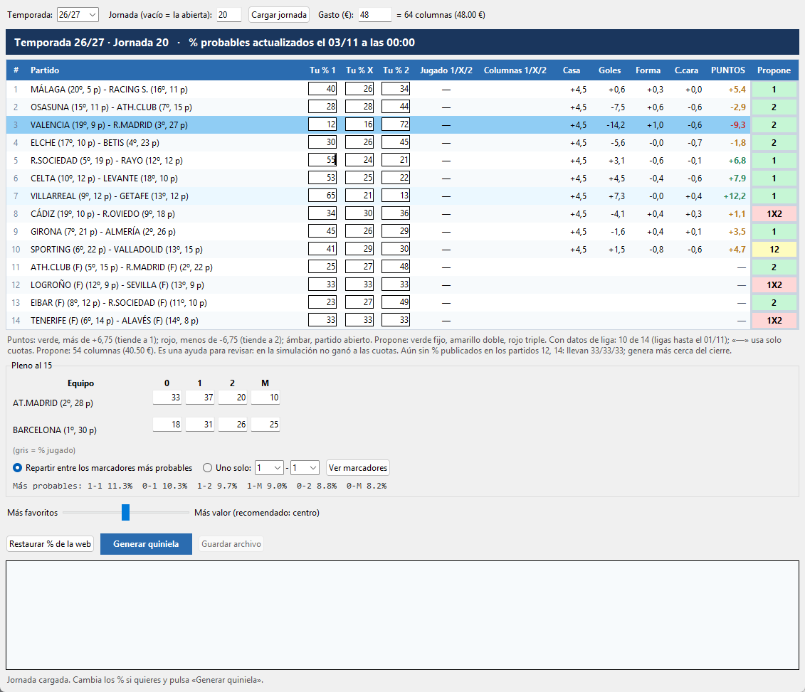

# Quinielas

Programa gratuito para Windows que ayuda a **hacer la quiniela de la semana**, **subirla a la web de eduardolosilla.es** y **seguirla en directo**: aciertos, premios estimados y lo que cobrarías.



> ⚠️ **Antes de nada:** la quiniela es un juego de azar. De cada euro jugado, solo unos 55 céntimos vuelven en premios. Este programa **no garantiza premios ni ganancias**: ayuda a elegir columnas con criterio y a seguir tu boleto. Juega solo lo que estés dispuesto a perder. Solo para mayores de 18 años. ¿Necesitas ayuda? [jugarbien.es](https://www.jugarbien.es)

---

## Qué hace

- **Genera tu quiniela.** Elige las columnas según tu presupuesto, a partir de la probabilidad de cada resultado (cuotas de apuestas) y de lo que juega la gente. Busca resultados probables pero poco jugados, porque si salen se cobra más.
- **Te deja decidir.** Puedes cambiar los % de cada partido y del pleno al 15, ver la clasificación de los equipos y una tabla de puntos (casa, goles, forma, cara a cara) que propone un signo para cada partido.
- **Guarda el fichero en el formato de eduardolosilla**, listo para subirlo y jugarlo.
- **Sigue tu boleto en directo.** Resultados al minuto, tus columnas ordenadas por aciertos, gráfica de aciertos posibles, premios estimados (mínimo y máximo, con el mismo cálculo que la web) y la mejor posibilidad de lo que puedes cobrar.
- **Simula resultados.** Toca un signo o un marcador y verás cómo cambiarían tus aciertos y premios, sin tocar los resultados reales.
- **Historial de jornadas.** Guarda tus boletos, con nombre y varios por jornada. Cierra cada boleto con los premios oficiales y lleva la cuenta de lo jugado, lo cobrado y el balance.
- **Hora de cierre** de la jornada, para no llegar tarde.



---

## Instalación (Windows)

1. **Instala Python** (gratis) desde [python.org/downloads](https://www.python.org/downloads/). Necesitas la versión **3.12 o superior**.
   - En la primera pantalla del instalador, **marca la casilla "Add python.exe to PATH"**.
2. **Descarga el programa.** Arriba en esta página, pulsa el botón verde **`<> Code`** y luego **`Download ZIP`**.
3. **Descomprime el ZIP** donde quieras, por ejemplo en `C:\quinielas`.
4. **Doble clic en `Quiniela.bat`.**
   - La primera vez instala lo que necesita (numpy) y descarga datos de las ligas. Puede tardar uno o dos minutos.
   - Necesita conexión a internet: los datos de cada jornada se descargan al momento.

Si al abrirlo sale un error en la ventana negra, cópialo y abre una [incidencia](../../issues) en GitHub.

---

## Cómo se usa

### 1. Generar la quiniela de la semana

1. En la ventana principal, pulsa **"Generar quiniela..."**.
2. Deja la jornada vacía y pulsa **"Cargar jornada"**: se carga la jornada abierta con sus 14 partidos y el pleno.
   - Arriba a la derecha verás la **hora de cierre**.
   - Junto a cada equipo, su **posición y puntos** en la liga.
   - **Tu % 1 / X / 2:** la probabilidad de cada resultado según las cuotas. Puedes cambiarlos si crees otra cosa.
   - **Jugado:** lo que juega la gente.
   - **PUNTOS y Propone:** la tabla de puntos, una ayuda para revisar. Verde: tiende al 1. Rojo: tiende al 2. Ámbar: partido abierto.
3. Pon el **gasto** en euros. Cada columna cuesta 0,75 €, así que 48 € son 64 columnas.
4. **Pleno al 15:** revisa los % de goles (0, 1, 2, M) de cada equipo. Puedes repartir el pleno entre los marcadores más probables o poner uno solo.
5. La barra **"Más favoritos ↔ Más valor"** cambia el estilo. En el centro es lo que mejor ha funcionado en las pruebas.
6. Pulsa **"Generar quiniela"**. Verás las columnas, la probabilidad de hacer 12, 13, 14 y 15, y cuánto pagaría cada columna si la aciertas.
7. Pulsa **"Guardar archivo"**. Se guarda en la carpeta `jornadas_generadas`.

> Consejo: genera la quiniela lo más cerca posible del cierre. Los % de las cuotas y de lo jugado se actualizan durante la semana.

### 2. Subir el fichero a eduardolosilla.es y jugarlo

El fichero que guarda el programa usa el formato que acepta la web: una apuesta por línea, con 14 signos y el pleno en goles pegado al final (por ejemplo `21X1122111X21211`, donde el pleno es `1-1`).

1. Entra en [eduardolosilla.es](https://www.eduardolosilla.es) con tu cuenta.
2. Ve a **Quiniela → Validar Quiniela - Archivos de programas**: [eduardolosilla.es/quiniela/archivos](https://www.eduardolosilla.es/quiniela/archivos).
3. Pulsa **"Elegir archivos"** y selecciona tu fichero de la carpeta `jornadas_generadas`.
4. En **"Número de apuestas en el archivo"**, pon el número de columnas (64 si has jugado 48 €). Comprueba que el importe coincide.
5. Pulsa **"Enviar para jugar"** y sigue los pasos de la web para pagar.

> El programa **no juega ni paga nada por ti**. Solo prepara el fichero. La apuesta la haces tú en la web.

### 3. Cargar tu apuesta real en el programa

Para seguir tu boleto en directo, cárgalo en la ventana principal:

1. Pulsa **"Cargar fichero de la jornada..."**.
2. **Pega el enlace** del fichero de tu apuesta en eduardolosilla. Es un enlace del tipo `https://files.eduardolosilla.es/redus/1X2/2027/18/...txt`. También puedes **dejarlo vacío** y elegir un archivo de tu ordenador.
3. Confirma la temporada y la jornada. Si vienen en el enlace o en el nombre del fichero, ya aparecen rellenas.
4. Responde **Sí** a "¿Es este el fichero REAL de apuestas?" y ponle un nombre si quieres. A partir de ahí el programa se abrirá siempre con ese boleto hasta que cargues el de la jornada siguiente.
   - Si en esa jornada ya tienes otro boleto, te pregunta si quieres añadirlo como otro o sustituir el anterior.

### 4. Seguir la jornada en directo

Con **"Auto cada 60 s"** marcado, todo se actualiza solo:

- **Partidos:** resultado y minuto en directo, el % de tus columnas con cada signo y el % que acierta el resultado actual.
- **Apuestas:** tus columnas en vertical, ordenadas por aciertos. Verde es acierto, rojo es fallo. Las flechas ‹ › pasan de página.
- **Gráfica de aciertos:** cuántas columnas pueden llegar a 10, 11, 12, 13, 14 o 15, contando como acertados los partidos que faltan.
- **Premios:** acertantes y premio estimado (mínimo y máximo) de cada categoría, con el mismo método que la web.
- **Mejor posibilidad:** lo máximo que podrías cobrar si lo que falta sale bien.
- **Simular:** toca un 1, X o 2, o la casilla ✎ de "Simular", y escribe un resultado. Verás cómo cambiaría todo. El marcador real no se toca, y "Quitar simulación" vuelve a la realidad.

> Las estimaciones de premios son aproximadas: el premio real puede salir bastante distinto. El oficial llega con el escrutinio.

### 5. Cerrar el boleto

Cuando la jornada esté escrutada (normalmente uno o dos días después), pulsa **"Cerrar boleto"**. El programa baja los premios oficiales, te enseña el detalle y lo guarda en el historial. Ahí verás jornada a jornada lo jugado, lo cobrado y el balance total.

---

## ¿Funciona? Lo que dicen las pruebas

El programa se ha probado con **más de 700 jornadas reales** (temporadas 2016/17 a 2026/27). Para cada jornada se generaron las columnas sin conocer los resultados y se calculó lo que se habría cobrado con los premios oficiales. Con 48 € por jornada:

- **Hay algún premio en algo más de la mitad de las jornadas,** casi siempre pequeño (10 u 11 aciertos).
- **13 aciertos o más:** en torno a 1 de cada 25 jornadas. **14:** muy pocas veces.
- **La estrategia de "valor" pierde bastante menos que jugar a favoritos,** pero **de media sigue perdiendo dinero**: entre un 25 % y un 50 % de lo jugado, salvo que caiga un premio gordo.
- **Ninguna fórmula probada gana de forma fiable a la quiniela:** puntos propios, patrones de resultados, jugar más o menos dinero, triples frente a dobles, etc.

Los informes completos están en [`docs/informes`](docs/informes).

---

## De dónde salen los datos

- **Partidos, % de cuotas, % jugados, resultados, premios y hora de cierre:** datos públicos de [eduardolosilla.es](https://www.eduardolosilla.es).
- **Clasificaciones:** páginas públicas de [laliga.com](https://www.laliga.com).
- **Ligas completas de Primera y Segunda** (para la tabla de puntos): [football-data.co.uk](https://www.football-data.co.uk).

Este proyecto **no está afiliado** a eduardolosilla.es, a Loterías y Apuestas del Estado ni a LaLiga. Usa solo información pública y la descarga con moderación. Si alguna web cambia, alguna función puede dejar de ir hasta que se actualice el programa.

---

## Para curiosos (avanzado)

Junto al programa va el motor de simulación con el que se hicieron las pruebas:

```bash
python fetch.py 2017 2027            # descarga el histórico de jornadas (tarda)
python build.py                      # lo convierte en data/partidos.csv y data/jornadas.csv
python -m engine.run --strategy valor_mix --budget 48 --from 2017 --to 2026 --out results/valor
python temporada_programa.py 2026 48 # rejuega una temporada entera como lo haría el programa
python puntos_jornada.py             # tabla de puntos de la jornada abierta
python -m unittest discover -s engine/tests -t .
```

Las estrategias están en `strategies/`; la que usa el programa es `valor_mix.py`.

---

## Apoya el proyecto

El programa es gratuito. Si te resulta útil y quieres invitarme a un café: **[Donar con PayPal](https://paypal.me/Iquinielas)** ☕

También puedes usar el botón **"♥ Donar"** del propio programa.

## Licencia

[MIT](LICENSE): puedes usarlo, copiarlo y modificarlo libremente, sin garantía de ningún tipo.
